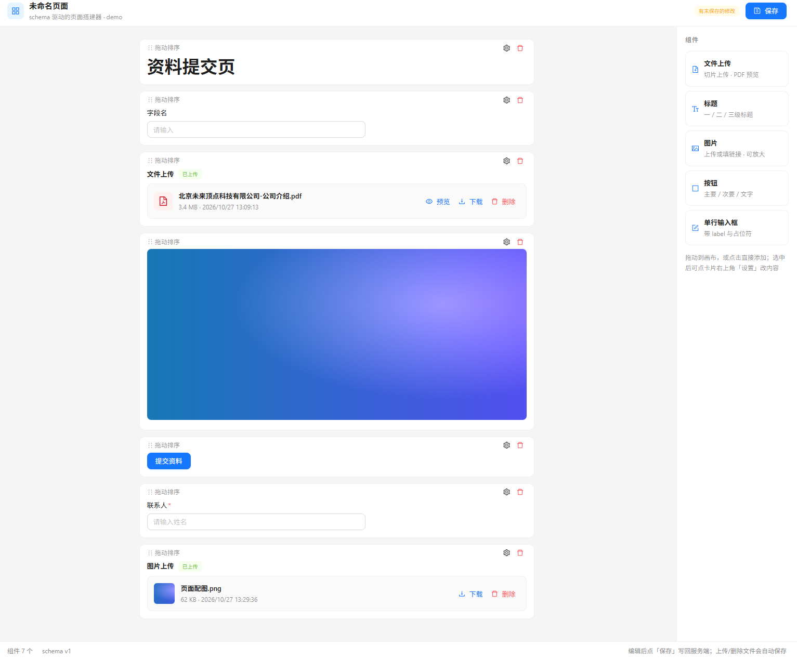

# 页面搭建器 Demo（文件上传）

基于接口返回的 schema 动态渲染的页面，左侧是画布，右侧是组件，图方便目前只做了上下列表形式的展示，之后可优化为在画布中的任意地方都可以随便摆放并且可调整组件大小和属性；
初始渲染和保存修改都去修改同一个数据源，也就是 schema，还有很多属性可以添加，目前只做了最基础的；
主要是为了演示文件上传和预览的原型效果，文件做了切片上传的功能；
前端使用 react，后端使用 nodejs，数据库和文件都存在项目的 data 文件夹中，实际生产环境肯定不能这么搞，主要还是为了演示；
单文件目前上限给了 2G，断点续传和秒传也还没做，分片大小是在后端接口中固定的；
模拟的是单用户，所以接口里走的都是 default；
可以预览 pdf 和图片。

这是我脑中的大概方案，主要还是觉得做出来应该没啥问题，搞个 demo 出来比用嘴说好一点，当然各种意义上都很简陋，只是快速搞了个可落地项目，烦请过目。

依赖项需要装一下然后再运行

## 运行

```powershell
cd D:\workspace\page-builder-demo
npm install
npm run dev
```

打开 http://localhost:5173


